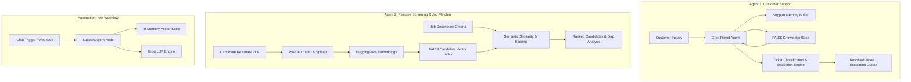

# 🎧 AI Customer Support & Resume Screening Agent Suite

A production-grade dual-agent application built with **LangChain**, **LangGraph**, **Groq (LLaMA-3)**, **FAISS Vector Search**, and **n8n Workflow Automation**, featuring:
1. **Intelligent Customer Support Agent:** Multi-turn customer resolution with automated ticket classification, knowledge base retrieval, and escalation handling.
2. **Automated Resume Screening Engine:** PDF document extraction, semantic profile matching, candidate ranking, and gap analysis.
3. **End-to-End n8n Automation Workflow:** Full low-code pipeline definition orchestrating vector stores, Groq LLM triggers, and webhook endpoints.

---

## 🌟 Architecture



---

## ✨ Core Modules

### 1. 🎧 AI Customer Support Agent
- **Automated Issue Categorization:** Categorizes tickets into standard domains (`Billing & Payments`, `Technical Support`, `Account Management`, `Product Information`).
- **Context-Aware Retrieval:** Queries an indexed FAISS knowledge base of policy and technical documentation.
- **Intelligent Escalation Routing:** Automatically flags complex cases for human tier-2 support when confidence thresholds are not met.
- **Persistent Conversation Memory:** Tracks interaction state across multi-turn dialogs.

### 2. 📄 Resume Screening & Candidate Matching
- **Document Ingestion:** Automated batch parsing of applicant resumes from PDF files using `PyPDFLoader`.
- **Dense Vector Embeddings:** Uses `sentence-transformers` for embedding extraction of work experiences and competencies.
- **Skill & Requirement Gap Analysis:** Compares candidate profiles directly against role requirements to produce relevance scores and actionable feedback.

### 3. ⚡ n8n Low-Code Automation (`n8n_support_and_screening_workflow.json`)
- Complete, exportable **n8n workflow** integrating:
  - Manual triggers & Code nodes for KB data ingestion
  - `@n8n/n8n-nodes-langchain.vectorStoreInMemory`
  - `@n8n/n8n-nodes-langchain.embeddingsHuggingFaceInference`
  - `@n8n/n8n-nodes-langchain.agent` with `lmChatGroq`

---

## 🛠️ Tech Stack

| Component | Technology |
|---|---|
| **Agent Framework** | [LangChain](https://www.langchain.com/) & [LangGraph](https://www.langchain.com/langgraph) |
| **Inference Engine** | [Groq](https://groq.com/) (LLaMA-3.3-70B / LLaMA-3) |
| **Embeddings** | HuggingFace `sentence-transformers` |
| **Vector Database** | [FAISS](https://github.com/facebookresearch/faiss) |
| **Workflow Automation** | [n8n](https://n8n.io/) |
| **Document Processing** | `pypdf`, `RecursiveCharacterTextSplitter` |

---

## 🚀 Getting Started

### 1. Installation

Clone this repository and install dependencies:

```bash
git clone https://github.com/tasneemibrahim-ai/AI-Customer-Support-and-Resume-Screening.git
cd AI-Customer-Support-and-Resume-Screening
pip install -r requirements.txt
```

### 2. Environment Setup

Create `.env` from `.env.example`:

```bash
cp .env.example .env
```

Add your Groq API key:

```ini
GROQ_API_KEY=gsk_your_groq_api_key_here
```

### 3. Running the Python Pipelines

Launch Jupyter Notebook:

```bash
jupyter notebook customer_support_and_resume_screening.ipynb
```

### 4. Importing the n8n Workflow

1. Open your self-hosted or cloud [n8n](https://n8n.io/) instance.
2. Navigate to **Workflows** → **Import from File**.
3. Select `n8n_support_and_screening_workflow.json`.
4. Configure your Groq and HuggingFace API credentials in n8n.

---

## 📂 Project Structure

```
AI-Customer-Support-and-Resume-Screening/
├── customer_support_and_resume_screening.ipynb   # Main dual-agent LangChain notebook
├── n8n_support_and_screening_workflow.json      # Complete n8n automation workflow
├── requirements.txt                              # Project dependencies
├── .env.example                                  # Template for environment variables
├── .gitignore                                    # Git exclusion rules
└── README.md                                     # Full documentation
```

---

## 👨‍💻 Author

**Tasneem Ibrahim**  
- GitHub: [@tasneemibrahim-ai](https://github.com/tasneemibrahim-ai)
